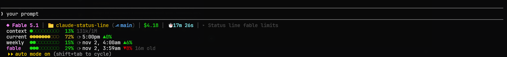

# claude-status-line

A three-line status line for [Claude Code](https://code.claude.com) written in plain Python:
one line of session info and a two-column grid of progress bars, including a separate bar for every
model-scoped limit your plan has (Fable today).
No `jq`, no extra dependencies, and no network calls unless you opt in to the live limit refresh below.



Plain text rendering:

```
◆ Fable 5.1 │ 📁 prounitas-backend (⎇ feature-branch*) │ $4.80 │ ⏱ 31m 58s │ ▸ Add statusline
context ●○○○○○○○○○  11% 111k/1M      │ weekly  ●○○○○○○○○○  10% ⟳ sep 21, 5:00am ▲46%
current ○○○○○○○○○○   2% ⟳ 8:10am ▲0% │ fable   ●●●○○○○○○○  27% ⟳ sep 21, 5:00am ▲29%
```

## What it shows

**Line 1**

| Segment | Meaning |
|---|---|
| `◆ Fable 5.1` | Model display name, bold pink |
| `📁 dir (⎇ branch*)` | Current folder and git branch. `*` appears when the working tree has uncommitted changes |
| `$4.80` | Estimated session cost at API list price. Informational only on a subscription |
| `⏱ 31m 58s` | Wall-clock session duration |
| `▸ name` | Session name from `/rename` or the AI-generated title. Hidden when absent |

**Lines 2 and 3**: progress bars in two columns. The left column is what is current: the context
window and the 5-hour limit. The right column is the weekly windows: the plain weekly limit and every
model-scoped one. The left column is padded so the right column lines up. Each bar is ten circles and
resolves to 5%: odd steps show the next circle filled but dimmed. Only `●` and `○` are used, because a
third glyph such as `◐` often comes from a fallback font at a different size.

| Row | Meaning |
|---|---|
| `context` | Context window used, plus tokens in context over the window size (`111k/1M`) |
| `current` | 5-hour rate limit used, `⟳` local reset time, and a pace indicator |
| `weekly` | 7-day rate limit used, `⟳` reset date and time, and a pace indicator |
| `fable` | One row per model-scoped limit, named after the model (or surface) the server reports, in the same pink as the model name. Shown only when your plan has one |

Colors follow one scale everywhere: green below 50%, orange to 69%, yellow to 89%, red from 90%.

**Pace** compares your usage to a straight line from window start to reset.
`▲30%` means you have 30 points of headroom versus linear burn. `▼5%` means you are burning faster than linear.

When Claude Code does not send rate limit data, the row shows a dim placeholder so the layout never shifts.

The grid is about 90 columns wide. Set `CLAUDE_STATUSLINE_STACKED=1` to get one bar per row instead;
the script also stacks on its own when it can read the terminal width and the grid would not fit.

**Model-scoped limits.** Claude Code's status line input only carries the 5-hour and 7-day windows.
The per-model buckets (the separate Fable allowance, for example) are read from the usage snapshot
Claude Code itself caches in `~/.claude.json` (honours `CLAUDE_CONFIG_DIR`). Claude Code fetches that
snapshot at session start and when you open `/usage`, not continuously. To keep the bar moving in
between, the script uses the fact that the snapshot states the bucket's allowance as a share of the
weekly budget: while the session runs that model, any growth of the live weekly number is that model's
usage, so it is projected onto the bucket. When the session runs a different model the snapshot value is
shown as is, with a dim `Nh old` marker once it is more than an hour old. Opening `/usage` refreshes it.
Should a future Claude Code version start sending such a window on stdin, the live value is used instead.

**Live refresh (opt-in).** Set `CLAUDE_STATUSLINE_FETCH_USAGE=1` and the script asks the same usage
endpoint Claude Code uses, at most once a minute, from a detached background process so the status line
never waits on the network. It authenticates with the OAuth access token Claude Code already stores in
`~/.claude/.credentials.json`; the token is sent only to `api.anthropic.com` and never written anywhere
else. The result lands in `~/.claude/statusline-usage.json` and is used whenever it is newer than
Claude Code's own snapshot. On macOS the token lives in the keychain rather than a file, so the refresh
stays inactive there. Enable it via the `env` block in `~/.claude/settings.json`:

```json
{
  "env": { "CLAUDE_STATUSLINE_FETCH_USAGE": "1" }
}
```

## Install

```bash
mkdir -p ~/.claude
curl -sL https://raw.githubusercontent.com/denyswsu/claude-status-line/main/statusline.py -o ~/.claude/statusline.py
chmod +x ~/.claude/statusline.py
```

Then add to `~/.claude/settings.json`:

```json
{
  "statusLine": {
    "type": "command",
    "command": "python3 ~/.claude/statusline.py",
    "padding": 0
  }
}
```

Optional: add `"refreshInterval": 30` inside `statusLine` so reset times and pace stay current while the session is idle.

Requires Python 3.6+ and a terminal with 256-color or true-color support.

## Debugging

Set `CLAUDE_STATUSLINE_DEBUG=1` in the environment Claude Code runs in and the script writes the last JSON it received to `~/.claude/statusline-last-input.json`.

Test locally with sample input:

```bash
echo '{"model":{"display_name":"Opus"},"cwd":"'$PWD'","cost":{"total_cost_usd":1.2,"total_duration_ms":754000},"context_window":{"used_percentage":42,"total_input_tokens":84000,"context_window_size":200000},"rate_limits":{"five_hour":{"used_percentage":30,"resets_at":'$(( $(date +%s) + 7200 ))'},"seven_day":{"used_percentage":74,"resets_at":'$(( $(date +%s) + 300000 ))'}}}' | python3 ~/.claude/statusline.py
```

To preview the model-scoped row without a real snapshot, point `CLAUDE_CONFIG_DIR` at a folder holding a
`.claude.json` like this and run the command above with that variable set:

```json
{"cachedUsageUtilization":{"fetchedAtMs":1793107182707,"utilization":{
  "seven_day":{"utilization":15},
  "limits":[{"kind":"weekly_scoped","percent":29,"resets_at":"2026-11-02T01:59:59+00:00",
             "scope":{"model":{"display_name":"Fable"}}}],
  "weekly_scoped_shares":[{"limit_index":0,"used_percent_of_weekly":15,"allowance_percent_of_weekly":50}]}}}
```

## Credits

Started from [razamit's gist](https://gist.github.com/razamit/34670a1afa015c9224787ab133970e76).
The circle progress bars and the `current` / `weekly` layout are borrowed from [nilbuild/claude-statusline](https://github.com/nilbuild/claude-statusline) (MIT).

## License

MIT
